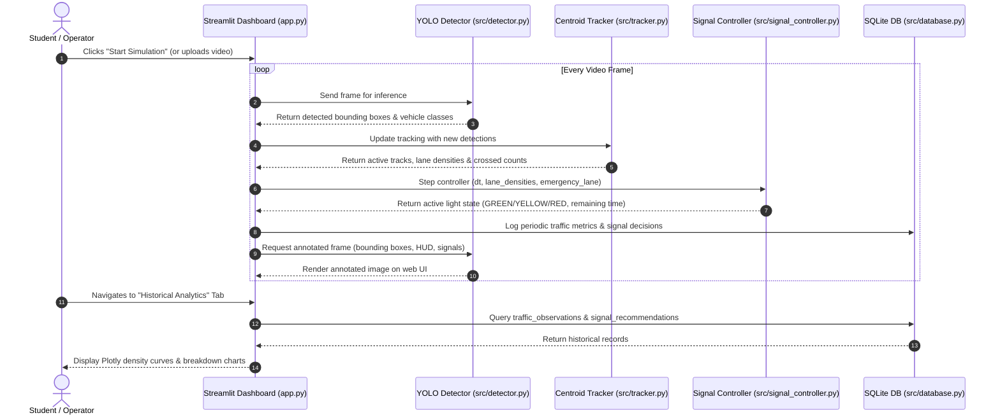

# 🚦 Smart Emergency Traffic Priority System

An intelligent, AI-powered traffic management and emergency preemption simulation built with **Python**, **OpenCV**, **Ultralytics YOLOv8**, **Streamlit**, and **SQLite**.

Designed specifically as a clean, beginner-friendly, and mathematically sound Computer Science & Engineering (CSE) mini-project.

---

## 📌 Project Overview

Traditional traffic lights operate on rigid, fixed-time timers (e.g., 30 seconds per lane) regardless of whether a lane has 20 cars or zero cars. This leads to unnecessary congestion, fuel waste, and life-threatening delays for emergency response vehicles.

The **Smart Emergency Traffic Priority System** solves this by:
1. **Detecting Vehicles:** Using a pretrained **YOLOv8** model to recognize cars, motorcycles, buses, and trucks.
2. **Persistent Tracking:** Assigning unique IDs to vehicles and counting them as they cross a virtual tripwire (preventing double-counting).
3. **Adaptive Green-Time Calculation:** Dynamically scaling green light duration based on live vehicle density ($T_{\text{green}} = T_{\text{base}} + k \times N_{\text{vehicles}}$) clamped within $[T_{\text{min}}, T_{\text{max}}]$.
4. **Starvation Prevention:** Guaranteeing a turn to quieter lanes so they are never stranded indefinitely.
5. **Emergency Simulation Priority:** Allowing an instant preemptive clearance phase for emergency vehicles in a safe simulation mode.
6. **Data Persistence & Audit:** Logging every traffic observation and signal transition to an embedded **SQLite** database for historical analysis.

> [!IMPORTANT]
> **Safety & Academic Integrity Notice:**
> - Standard pretrained YOLO models (trained on the Microsoft COCO dataset) recognize general vehicles (`car`, `motorcycle`, `bus`, `truck`), but do **not** have an out-of-the-box class for ambulances or fire engines.
> - In this project, emergency priority is implemented as an explicit, clearly labeled **simulation override**.
> - This system is designed solely for educational simulation and academic research. It is **never** connected to real-world traffic infrastructure.

---

## 📂 Project Directory Structure

```text
smart_traffic_system/
│
├── .venv/                         # Isolated Python virtual environment
│
├── data/                          # Data storage directory
│   ├── sample_traffic.mp4         # Self-contained synthetic 3-lane test footage
│   └── traffic_system.db          # SQLite database storing observations & decisions
│
├── src/                           # Core backend modules
│   ├── __init__.py                # Package initializer
│   ├── detector.py                # Pretrained YOLOv8 vehicle detection & annotation
│   ├── tracker.py                 # Centroid multi-object tracker & line-crossing counter
│   ├── signal_controller.py       # Density-based timing, starvation logic & emergency preemption
│   ├── database.py                # SQLite schema, transactional insertions & analytical queries
│   └── video_generator.py         # OpenCV generator for realistic multi-lane synthetic test video
│
├── tests/                         # Automated unit & integration tests
│   ├── __init__.py
│   ├── test_signal.py             # Unit tests for green-time math, bounds, and preemption
│   ├── test_db.py                 # Unit tests for SQLite table creation & operations
│   └── test_pipeline.py           # End-to-end integration test (Video -> YOLO -> Tracker -> DB)
│
├── app.py                         # Streamlit interactive web dashboard
├── requirements.txt               # Project dependencies
└── README.md                      # Comprehensive guide and viva preparation
```

---

## ⚙️ How Data Flows Through the System



---

## 🛠️ Step-by-Step Module Explanation

| Module | What It Does | Why It Matters |
| :--- | :--- | :--- |
| [`src/detector.py`](src/detector.py) | Wraps Ultralytics YOLOv8n to detect objects of class `car` (2), `motorcycle` (3), `bus` (5), and `truck` (7). Draws bounding boxes, confidence tags, and lane-status overlays. | Avoids training heavy models from scratch by leveraging state-of-the-art pretrained computer vision. |
| [`src/tracker.py`](src/tracker.py) | Calculates bounding box centroids and uses Euclidean distance to track vehicles across consecutive frames. Tracks when a centroid crosses the virtual counting line. | Without tracking, a stationary or moving car would be re-counted on every single frame. |
| [`src/signal_controller.py`](src/signal_controller.py) | Implements dynamic green-time formula: $T = \text{clamp}(T_{\text{base}} + k \cdot N, T_{\text{min}}, T_{\text{max}})$. Enforces starvation thresholds and emergency overrides. | Optimizes traffic throughput while preventing quieter lanes from waiting indefinitely. |
| [`src/database.py`](src/database.py) | Manages SQLite tables (`traffic_observations` and `signal_recommendations`) with WAL mode and safe connection handling. | Persists operational data for post-run analytics, reporting, and professor demonstrations. |
| [`src/video_generator.py`](src/video_generator.py) | Uses OpenCV to render a realistic 3-lane road with dashed lines, cars, bikes, trucks, and a simulated ambulance with flashing emergency beacon. | Guarantees the student can test immediately without relying on external internet downloads or broken links. |
| [`app.py`](app.py) | Streamlit dashboard featuring live video streaming, real-time colored traffic light badges, emergency controls, and Plotly charts. | Delivers a clean, interactive GUI for demonstrations, project exhibitions, and viva evaluations. |

---

## 🚀 Exact Windows Launch Commands

Follow these simple steps in **PowerShell**:

### 1. Navigate to the Project Directory
```powershell
cd "C:\Users\acer\.gemini\antigravity\scratch\smart_traffic_system"
```

### 2. Run the Automated Tests (Verification)
Verify that all unit tests and integration pipelines pass:
```powershell
.\.venv\Scripts\python.exe -m unittest discover -s tests -p "test_*.py"
```

### 3. Launch the Streamlit Dashboard
```powershell
.\.venv\Scripts\python.exe -m streamlit run app.py
```

Streamlit will open in your default browser at:
👉 `http://localhost:8501`

---

## 🎯 How to Demo the Project to Evaluators

1. **Start the Baseline Run:**
   - Select `Sample 3-Lane Traffic (Built-in)` in the sidebar.
   - Click **Start Simulation**.
   - Show that bounding boxes appear with persistent IDs (`#1 car`, `#2 motorcycle`, etc.).
   - Point out that when vehicles cross the yellow tripwire line, the `Cumulative Passed` count increases **without duplicate counting**.
2. **Demonstrate Dynamic Signal Timing:**
   - Notice that Lane 1 (which has the highest traffic) receives longer green light duration than Lane 3.
   - Point out the countdown timer and how the light cycles safely through `YELLOW` $\to$ `ALL_RED` $\to$ `GREEN`.
3. **Trigger the Emergency Simulation:**
   - In the sidebar, check **Activate Emergency Simulation Mode** and select **Lane 2**.
   - Show how the active light immediately transitions to Yellow and yields a priority Green clearance to Lane 2.
   - Explain the academic safety disclaimer displayed on screen.
4. **Show Historical Analytics:**
   - Switch to the **Historical Analytics & Database** tab.
   - Showcase the real-time Plotly density curves, vehicle classification breakdown, and the recorded signal transition log from SQLite.

---

## 🎓 Viva Questions and Answers (Preparation for CSE Students)

### Q1: What is the fundamental difference between Object Detection and Object Tracking?
> **Answer:** **Detection** identifies and locates objects in an isolated frame without any memory of previous frames. If a car appears in 30 frames, detection detects it 30 separate times. **Tracking** associates detections across consecutive frames by calculating spatial proximity (e.g., centroid Euclidean distance) or appearance features, giving each physical vehicle a consistent ID across time.

### Q2: Why did you use a pretrained YOLO model instead of training your own model from scratch?
> **Answer:** Pretrained YOLOv8 models (like YOLOv8n) are trained on Microsoft COCO, a massive dataset of over 1.5 million labeled instances across 80 common categories. Training a model of similar accuracy from scratch would require thousands of annotated traffic images and high-end GPU resources. Using transfer learning and pretrained weights is the industry-standard best practice for rapid prototyping.

### Q3: Why doesn't standard YOLO recognize an ambulance as an emergency vehicle?
> **Answer:** The Microsoft COCO dataset includes general transportation classes (`car`, `motorcycle`, `bus`, `truck`), but does not have a distinct class for `ambulance` or `fire engine`. In real-world smart cities, emergency preemption is typically achieved via V2X (Vehicle-to-Infrastructure) radio beacons or specialized custom-trained models. For this mini-project, we responsibly implement an explicit, labeled Emergency Priority Simulation mode.

### Q4: How does your dynamic signal timing algorithm work mathematically?
> **Answer:** The green light duration $T_{\text{green}}$ is calculated as:
> $$T_{\text{green}} = \min\left(T_{\text{max}}, \max\left(T_{\text{min}}, T_{\text{base}} + k \cdot N\right)\right)$$
> where:
> - $T_{\text{base}}$ is the base minimum time (e.g., 10 seconds).
> - $k$ is the extension factor per detected vehicle (e.g., 2.5 seconds).
> - $N$ is the number of active vehicles detected in that lane.
> - $T_{\text{min}}$ ensures pedestrian safety and acceleration startup clearance.
> - $T_{\text{max}}$ prevents excessive queuing on conflicting lanes.

### Q5: What is traffic starvation, and how does your project solve it?
> **Answer:** Starvation occurs when a high-density lane continuously hogs the green light while a low-density lane waits indefinitely. We solve this using a starvation counter (`wait_cycles`). If any lane waits for more than a threshold number of cycles (e.g., 2 cycles), it is automatically granted the next green phase regardless of other lanes' traffic density.

### Q6: Why did you choose SQLite over MySQL or MongoDB?
> **Answer:** SQLite is a serverless, zero-configuration, self-contained relational database that stores all tables in a single lightweight file (`traffic_system.db`). For an edge deployment or local workstation application, it eliminates the overhead of managing a separate database daemon while offering full ACID transactions and standard SQL query support.

### Q7: What are the main limitations and future scopes of this system?
> **Answer:**
> 1. *Weather & Night Conditions:* Low lighting or heavy rain can degrade YOLO bounding-box precision. Future scope: integrate thermal cameras or infrared illumination.
> 2. *Emergency Detection:* Future scope includes training a specialized custom YOLO model on localized emergency vehicle datasets (sirens, livery, and light bars) combined with audio siren classification.
> 3. *Network Coordination:* Connecting multiple intersection controllers using Reinforcement Learning (e.g., Q-learning or SUMO simulation) for green-wave corridor synchronization across an entire city grid.
